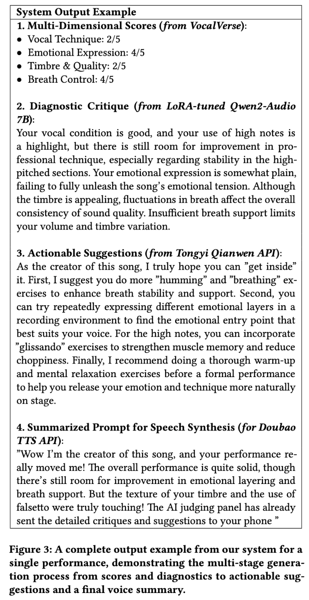

# KTV 重录打分实验归档-Cqy

## 数据与划分

完整数据池共 3,760 条：

| 数据来源 | 数量 | 分数范围 | 用途 |
| --- | ---: | ---: | --- |
| `2310` KTV 用户录音 | 2,310 | 30–92 | 1,925 条训练，385 条测试 |
| `2000_enhanced` KTV 重录扩充 | 1,450 | 59–99 | 只进入 mixed 训练集 |

“加入 GT85 数据”是加入 `2000/2000_enhanced` 重录来源的历史简称，不表示所有样本都大于 85 分。

| 设置 | 训练集 | 测试集 |
| --- | --- | --- |
| mixed | 3,375 条：1,925 KTV + 1,450 重录 | 385 条纯 KTV，30–84 分 |
| KTV-only | 1,925 条 KTV | 385 条纯 KTV，30–84 分 |

Pairwise 使用分组 JSON，直接回归使用相同样本的扁平 JSON：

| 用途 | Pairwise | 直接回归 |
| --- | --- | --- |
| mixed 训练 | `dataset/ktv_rerecord_3760/pairwise/train_mixed_3375.json` | `dataset/ktv_rerecord_3760/regression/train_mixed_3375.json` |
| KTV-only 训练 | `dataset/ktv_rerecord_3760/pairwise/train_ktv_only_1925.json` | `dataset/ktv_rerecord_3760/regression/train_ktv_only_1925.json` |
| 纯 KTV 测试 | `dataset/ktv_rerecord_3760/pairwise/test_ktv_lt85_385.json` | `dataset/ktv_rerecord_3760/regression/test_ktv_lt85_385.json` |

详细划分规则见 `dataset/ktv_rerecord_3760/split_note.md`。训练代码为兼容历史接口仍使用参数名 `--val_json`，本轮传入的是上述固定测试清单。

## 实验结果

下表只保留同一份 385 条纯 KTV 测试集上的结果；使用 mixed 测试集得到的约 `0.78` Pairwise accuracy 和约 `0.86` Pearson 不列入比较。Pairwise 均使用组内所有异分有序对。

| checkpoint | 初始化 | 训练集加入 mixed 重录数据 | 训练方法 | Pairwise 比较方向 | 训练步数 | Pearson |
| --- | --- | --- | --- | --- | ---: | ---: |
| `step_3_extended_audio/best_model_step_2000`（仅本地历史，未上传） | step2 续训 | 是：旧 mixed 3,758 | Pairwise | 反向：高分 raw `<` 低分 raw；推理用 `5 - raw` | 2,000 | 0.489811 |
| `pairwise_from_muq_mixed_step_9000` | 原始 MuQ + fresh LoRA | 是：mixed 3,375 | Pairwise | 正向：高分 raw `>` 低分 raw | 9,000 | 0.479695 |
| `regression_from_muq_mixed_r128_step_14200` | 原始 MuQ + fresh 回归头 | 是：mixed 3,375 | 直接回归 r128 | — | 14,200 | 0.4733 |
| `regression_from_muq_mixed_r32_step_13200` | 原始 MuQ + fresh 回归头 | 是：mixed 3,375 | 直接回归 r32 | — | 13,200 | 0.4813 |
| `regression_from_muq_ktv_only_r32_step_6600` | 原始 MuQ + fresh 回归头 | 否：KTV-only 1,925 | 直接回归 r32 | — | 6,600 | **0.514830** |
| `step_2_al_audio/best_model_step_132000`（线上旧版） | —：线上基线 | 原训练清单缺失 | Pairwise | 反向：高分 raw `<` 低分 raw；推理用 `5 - raw` | 132,000 | **0.640597** |

表中的 `r128` 和 `r32` 分别表示 MuQ 编码器使用的 LoRA rank 为 128 和 32；两者的回归头结构相同，`r` 不是回归头维度。

`step_2_al_audio/best_model_step_132000` 的原始训练清单缺失，因此无法排除上述 385 条纯 KTV 测试样本与其训练数据重叠的可能。该模型的 `0.640597` 只作为同集参考，不能视为已排除数据泄露的泛化结果。

## 最终方案

- 本轮新实验选用 KTV-only 直接回归 step 6,600，归档为 `step_3_ktv_rerecord_highscore`。
- 该模型是本轮新方案中 Pearson 最高的版本，但没有超过当前线上旧版的同集结果，因此不替换线上权重。

## 训练命令

以下命令均在 `audioscore/` 目录执行：

```bash
export AUDIOSCORE_ARCHIVE=/archive/private_data/cqy/audio-score
```

Pairwise mixed：

```bash
CUDA_VISIBLE_DEVICES=0,1,2,3 torchrun \
  --nproc_per_node=4 --nnodes=1 \
  scripts/train/train_sort_audio.py \
  --train_json dataset/ktv_rerecord_3760/pairwise/train_mixed_3375.json \
  --val_json dataset/ktv_rerecord_3760/pairwise/test_ktv_lt85_385.json \
  --cache_base_dir /cache/cqy_cache/audio-score \
  --cache_dir "$AUDIOSCORE_ARCHIVE/pre_store_3760_full_24k" \
  --segment_duration 60 --epochs 10
```

最终 KTV-only 直接回归：

```bash
CUDA_VISIBLE_DEVICES=0,1,2,3 torchrun \
  --nproc_per_node=4 --nnodes=1 \
  scripts/train/train_regression_audio.py \
  --train_json dataset/ktv_rerecord_3760/regression/train_ktv_only_1925.json \
  --val_json dataset/ktv_rerecord_3760/regression/test_ktv_lt85_385.json \
  --cache_base_dir /cache/cqy_cache/audio-score \
  --cache_dir "$AUDIOSCORE_ARCHIVE/pre_store_3760_full_24k" \
  --epochs 50 --lora_r 32 --lora_alpha 32 \
  --warmup_max_steps 500 --segment_duration 90
```

## 推理命令

当前线上旧版：

```bash
python scripts/train/infer_sort_audio.py \
  --model_path ckpts/SongEvalGenerator/step_2_al_audio/best_model_step_132000 \
  --val_json dataset/ktv_rerecord_3760/pairwise/test_ktv_lt85_385.json \
  --cache_base_dir /cache/cqy_cache/audio-score \
  --val_cache_dir "$AUDIOSCORE_ARCHIVE/pre_store_3760_full_24k" \
  --val_cache_mode read --val_cache_kind full \
  --val_cache_cut_mode stable --segment_duration 90 --seed 1234 --inverse
```

最终 Pairwise：

```bash
python scripts/train/infer_sort_audio.py \
  --model_path ckpts/SongEvalGenerator/ktv_rerecord_experiments/pairwise_from_muq_mixed_step_9000 \
  --val_json dataset/ktv_rerecord_3760/pairwise/test_ktv_lt85_385.json \
  --cache_base_dir /cache/cqy_cache/audio-score \
  --val_cache_dir "$AUDIOSCORE_ARCHIVE/pre_store_3760_full_24k" \
  --val_cache_mode read --val_cache_kind full \
  --val_cache_cut_mode stable --segment_duration 90 --seed 1234
```

最终直接回归：

```bash
python scripts/train/infer_regression_audio.py \
  --model_path ckpts/SongEvalGenerator/step_3_ktv_rerecord_highscore \
  --val_json dataset/ktv_rerecord_3760/regression/test_ktv_lt85_385.json \
  --cache_base_dir /cache/cqy_cache/audio-score \
  --val_cache_dir "$AUDIOSCORE_ARCHIVE/pre_store_3760_full_24k" \
  --val_cache_cut_mode stable --segment_duration 90 --seed 1234
```

## Checkpoint 下载

### 最终 checkpoint

本轮最终 checkpoint 是 KTV-only 直接回归 `step_3_ktv_rerecord_highscore`：

```text
audioscore/ckpts/SongEvalGenerator/step_3_ktv_rerecord_highscore/
├── config.json
├── muq_lora.pt
├── regression_head.pt
└── type.txt
```

Hugging Face 下载地址：

<https://huggingface.co/karl-wang/QwenFeat-Vocal-Score/tree/main/audioscore/ckpts/SongEvalGenerator/step_3_ktv_rerecord_highscore>

在项目根目录运行以下命令，下载后文件将位于本地
`audioscore/ckpts/SongEvalGenerator/step_3_ktv_rerecord_highscore/`：

```bash
hf download karl-wang/QwenFeat-Vocal-Score \
  --include "audioscore/ckpts/SongEvalGenerator/step_3_ktv_rerecord_highscore/*" \
  --local-dir .
```

### 实验 checkpoint

除未上传的 step2 续训历史模型外，其余本轮 LoRA 实验 checkpoint 归档在：

<https://huggingface.co/karl-wang/vocalverse-highscore-expand-train-cqy/tree/main/audioscore/ckpts/SongEvalGenerator/ktv_rerecord_experiments>

在项目根目录运行：

```bash
hf download karl-wang/vocalverse-highscore-expand-train-cqy \
  --include "audioscore/ckpts/SongEvalGenerator/ktv_rerecord_experiments/**" \
  --local-dir .
```

下载后的本地目录为：

```text
audioscore/ckpts/SongEvalGenerator/ktv_rerecord_experiments/
├── pairwise_from_muq_mixed_step_9000/
├── regression_from_muq_mixed_r128_step_14200/
├── regression_from_muq_mixed_r32_step_13200/
└── regression_from_muq_ktv_only_r32_step_6600/
```


# VocalVerse Project Overview

[](https://www.arxiv.org/abs/2512.06999) 
[](https://doi.org/10.1145/3746027.3758148)

---

This work sincerely acknowledges the support of previous works such as **QwenAudio, SongEval, and MuQ**!.

All project resources, including **source code, model weights, and human-annotated datasets**, are now fully open-sourced.

# VocalVerse1: Singing Evaluation Model based on QwenAudio

[qwenaudio](./qwenaudio/README.md) **Qwen Comment Generation + Scoring Module**: This includes a Lora-trained version of Qwen-audio. It takes audio as input and outputs comments on issues in the singing voice (equivalent to descriptive tagging). These comments are then used as input for a "deep thinking" phase to perform the final timbre scoring. Finally, a TTS system with a singer's voice is used to generate the vocal critique. The full workflow is:

1. The fine-tuned Qwen model generates comments on singing issues.
2. Comments and audio are fed back into the Qwen scoring model to assist in evaluation (acting as a "deep thinking" step).
3. Another LLM call polishes the comments, generates a summary, and provides vocal suggestions.
4. Finally, the summary is read aloud using the corresponding singer's voice.

All weights for this section are preserved. Model directory link: Download the full repository containing models from Hugging Face: [https://huggingface.co/karl-wang/QwenFeat-Vocal-Score/] 


## Usage

### Download Models
Download the following directory and place it in the current path:
https://huggingface.co/karl-wang/QwenFeat-Vocal-Score/tree/main/qwenaudio/ckpts
Or simply run: `git clone https://huggingface.co/karl-wang/QwenFeat-Vocal-Score`

### Start Service

`python scripts/infer_service.py`  
Call via CURL:  
`curl -X POST http://localhost:8080/score -F "file=@/path/to/audio"`

### CLI Usage
`python scripts/infer.py path_to_audio.wav output_file.txt`

### Python API

Refer to `tests/test_score.py` for implementation.

```python
import qwenaudio.processor
import qwenaudio.prompts
import librosa

# Initialize model and processor
processor = qwenaudio.processor.create_processor(
            "ckpts/generator-lora-32-16-scoreonly-f16/best_model_epoch_13/lora_weights",
            "ckpts/generator-lora-32-16-textonly-simple-v2-int4/best_model_epoch_16/lora_weights"
        )

# Scoring
audio_path = "/home/w-4090/cutted_score_audio_separated/446892/344523004.wav"
data, sr = librosa.load(audio_path, sr=processor.processor.feature_extractor.sampling_rate, mono=True)
data = data[:processor.processor.feature_extractor.sampling_rate * 30] # Use first 30 seconds
print(data.shape)

for i in range(4):
    print("test:", qwenaudio.prompts.prompt_mapper_reverse[i]) # Meanings of parameters 0-4
    score = processor.generate(data, i) # Generate score
```

If model loading hangs, try using a Hugging Face mirror:
`export HF_ENDPOINT=https://hf-mirror.com`

## Additional Notes for VocalVerse1 (QwenAudio based)

- Use the `qwenaudio` conda environment; weights for both models have been included.
- Added `infer_service.py` and `infer.py` scripts; instructions are in the README. `test/test_score.py` is functional.
- The prompts are located at `/home/w-4090/projects/qwenaudio/src/qwenaudio/prompts.py`.
- Test scripts are available at `/home/w-4090/projects/qwenaudio/tests/test_processor_v2.py` and `/home/w-4090/projects/qwenaudio/tests/test_processor_v3.py`.
- For the code in Figures 1 and 2: when loading models locally, change the model paths in `model.py` and `processor.py` to your local paths.

 


- Figure 3 shows the two trained Lora models. These are ready and should be uploaded.


- The entire project including code and Lora weights is included, but the base model must be downloaded from the internet.
- If only the final classifier is active and the Lora on the model body is not, accuracy will be very low. Once Lora weights are active, accuracy reaches 80%-90%. (Encoder + LLM Decode + Lora + Classifier).
- Figure 4 shows that the `Qwen2-Audio-7B-Instruct/` base model is required. It was previously downloaded automatically to `.cache`; if downloaded manually, re-specify the path in the code.


## VocalVerse output


# VocalVerse2: Vocal Recording Scoring Model based on MuQ

[audioscore](./audioscore/README.md) **MuQ Scoring & Ranking Module**: Contains two versions (with and without decoupling) using the same codebase, organized into a single directory.

1. **Scoring using MuQ as encoder + scoring head**: No decoupling. This architecture is basically the same as the SongEval work. The unfrozen MuQ Lora weights and the scoring head weights are preserved. Link: [https://huggingface.co/karl-wang/QwenFeat-Vocal-Score/] 

2. **Decoupling Experiment**: Uses the speaker encoder from SaMoye-SVC for reverse gradient training to decouple speaker identity features, aiming to improve aesthetic understanding accuracy. The code is compatible with both versions. Note: Decoupling weights were lost due to a server move. However, experiments using SaMoye’s or Wespeaker’s encoder for reverse gradient training showed that while training and convergence are difficult (easier with smaller batch sizes), the final aesthetic assessment accuracy slightly improved, proving that decoupling is effective.

**Note**: This repository does not contain the model weights. Researchers should download the full repository including models from Hugging Face: [https://huggingface.co/karl-wang/QwenFeat-Vocal-Score/] 

## KTV Re-recording Experiment Archive (2026-05)

See [audioscore/README.md](./audioscore/README.md) for the dataset split, Pairwise and regression results, selected checkpoint, and training/inference commands.

- [Final checkpoint](https://huggingface.co/karl-wang/QwenFeat-Vocal-Score/tree/main/audioscore/ckpts/SongEvalGenerator/step_3_ktv_rerecord_highscore) — place at `audioscore/ckpts/SongEvalGenerator/step_3_ktv_rerecord_highscore/`.
- [Experiment checkpoints](https://huggingface.co/karl-wang/vocalverse-highscore-expand-train-cqy/tree/main/audioscore/ckpts/SongEvalGenerator/ktv_rerecord_experiments) — place at `audioscore/ckpts/SongEvalGenerator/ktv_rerecord_experiments/`.

## Usage

### Environment Setup

```bash
conda create -n audioscore python=3.10
conda activate audioscore
pip install -r requirements.txt
```

### Download Models
Download the following directory and place it in the current path:
https://huggingface.co/karl-wang/QwenFeat-Vocal-Score/tree/main/audioscore/ckpts
Or `git clone https://huggingface.co/karl-wang/QwenFeat-Vocal-Score`

### Inference
(Runnable code is available in `python tests/test_generate_score.py`)

```python
import os, sys
import audioscore.model

if __name__ == "__main__":
    ROOT_DIR = os.path.dirname(os.path.dirname(os.path.abspath(__file__)))
    model = audioscore.model.SongEvalGenerator_audio_lora()
    # Load model
    model.load_model(os.path.join(ROOT_DIR, "ckpts", "SongEvalGenerator", "step_2_al_audio", "best_model_step_132000")) 
    model = model.half() # Optional
    model = model.cuda()

    # Perform scoring
    score = model.generate_tag("/data/nfs/audioscore/data/sort/data/audio/203887_250822105518005501.m4a")

    print("score:", score)
```

Run tests directly:
```bash
python tests/test_generate_score.py
```

### Training

Direct Training:
`torchrun --nproc_per_node=4 --nnodes=1 scripts/train/train_sort_audio.py`

Adversarial Training (Decoupling with SaMoye spk encoder):
`torchrun --nproc_per_node=4 --nnodes=1 scripts/train/train_sort_audio_grl.py`

## 📜 License & Copyright

1. **License Framework**: This project is licensed under the **[CC BY-NC-ND 4.0](http://creativecommons.org/licenses/by-nc-nd/4.0/) (Attribution-NonCommercial-NoDerivs 4.0 International)** license.
2. **Non-Commercial Use**: The code, model weights, and documentation in this project are free for academic exchange and personal educational purposes only.
3. **Commercial Use Strictly Prohibited**: Without written authorization, it is strictly forbidden to use any part of this project for any form of commercial profit (including but not limited to integration into commercial software, providing commercial AI services, etc.).
4. **Commercial Licensing Inquiries**: For commercial cooperation or to obtain a commercial license, please contact: **3156018231@qq.com**.

---

## 🌍 Version Notice & Legacy Archive

**Legacy Repository**:  
[https://github.com/CarlWangChina/Singing-Aesthetic-Assessment](https://github.com/CarlWangChina/Singing-Aesthetic-Assessment)


## 📖 Paper Citation & Instructions

For detailed technical solutions, experimental results, and theoretical support regarding this implementation, please refer to our research paper. If you use the code or models from this repository in your research or work, please cite our paper.

### Paper Information

**Title**: Singing Timbre Popularity Assessment Based on Multimodal Large Foundation Model
**Conference**: Proceedings of the 33rd ACM International Conference on Multimedia (MM '25)

* **ACM Digital Library (Official Version)**: [https://doi.org/10.1145/3746027.3758148](https://doi.org/10.1145/3746027.3758148)
* **arXiv (Free Preview Version)**: [https://www.arxiv.org/abs/2512.06999](https://www.arxiv.org/abs/2512.06999) 
  *(Note: The arXiv version is identical in content to the official ACM DL version)*

### Citation Format

#### ACM Reference Format
> Zihao Wang, Ruibin Yuan, Ziqi Geng, Hengjia Li, Xingwei Qu, Xinyi Li, Songye Chen, Haoying Fu, Roger B. Dannenberg, and Kejun Zhang. 2025. Singing Timbre Popularity Assessment Based on Multimodal Large Foundation Model. In Proceedings of the 33rd ACM International Conference on Multimedia (MM '25). Association for Computing Machinery, New York, NY, USA, 12227–12236. https://doi.org/10.1145/3746027.3758148

#### BibTeX
```bibtex
@inproceedings{10.1145/3746027.3758148,
author = {Wang, Zihao and Yuan, Ruibin and Geng, Ziqi and Li, Hengjia ox and Qu, Xingwei and Li, Xinyi and Chen, Songye and Fu, Haoying and Dannenberg, Roger B. and Zhang, Kejun},
title = {Singing Timbre Popularity Assessment Based on Multimodal Large Foundation Model},
year = {2025},
isbn = {9798400720352},
publisher = {Association for Computing Machinery},
address = {New York, NY, USA},
url = {[https://doi.org/10.1145/3746027.3758148](https://doi.org/10.1145/3746027.3758148)},
doi = {10.1145/3746027.3758148},
booktitle = {Proceedings of the 33rd ACM International Conference on Multimedia},
pages = {12227–12236},
numpages = {10},
keywords = {computational music aesthetics, descriptive feedback, multi-dimensional evaluation, multimodal foundation models, singing timbre popularity, singing voice assessment},
location = {Dublin, Ireland},
series = {MM '25}
}
```

## 📂 Data Description

The VocalVerse_Datasets-human_labels folder contains three core files, providing two-level evaluation data (amateur and professional) for singing performance.

| File Name | Description |
| :--- | :--- |
| **`Amateur_overall_mos_avg5.xlsx`** | **Amateur Consensus Scores:** Contains overall "pleasantness" ratings from 165 amateur annotators. Each recording was rated by 5 independent annotators on a 1-5 Likert scale, and this file provides the final Mean Opinion Scores (MOS). |
| **`Professional_multidim_annotations_raw_...xlsx`** | **Expert Multi-dimensional Labels:** Detailed annotations provided by two professional vocal coaches. It includes 1-5 integer scores across four core dimensions—**Timbre, Breath, Emotion, and Technique**—along with accompanying **textual critiques**. |
| **`Professional_scoring_rubric.xlsx`** | **Scoring Standards:** The formal criteria (Rubric) used by experts to ensure consistency and high quality across the four dimensions. |

### Data Scale

According to the research paper:
* **Original Data Pool:** We initially collected over **100,000** raw a cappella recordings.
* **Pre-screened Set:** Following automated preliminary screening via manual and RuleSignal scoring, a dataset of **10,000** clips was formed.
* **Current Open-source Subset:** The files provided in this repository represent the **top 10% (approximately 1,000 recordings with high technical proficiency)**, which were subsequently subjected to intensive professional multi-dimensional annotation.

### Annotation Methodology

1. **Amateur Phase:** A total of 165 non-music major annotators participated. They employed a "forced distribution" method to ensure score differentiation and capture general aesthetic preferences.
2. **Professional Phase:** Two senior vocal teachers provided dual-modality annotations (scores + descriptive text) to support the training of descriptive Multimodal Large Language Models (MLLMs).
3. **Evaluation Dimensions:**
    * **Timbre Quality:** The uniqueness, texture, and layering of the voice.
    * **Breath Control:** Support and stability for complex phrases.
    * **Emotional Expression:** The infectiousness and resonance of the performance.
    * **Vocal Technique:** Mastery of singing skills.

### 🎵 Audio Dataset Access & Mapping

Due to GitHub's file size limitations, the raw audio recordings are hosted separately on Hugging Face.

* **Dataset Repository**: [https://huggingface.co/datasets/karl-wang/VocalVerse-dataset/](https://huggingface.co/datasets/karl-wang/VocalVerse-dataset/)

**How to Map Audio to Scores:**
To utilize the dataset, you need to map the audio files to the annotations provided in the Excel sheets (in the `VocalVerse_Datasets-human_labels` folder):
1.  **Locate IDs**: Refer to the **`Song ID`** and **`Record ID`** columns in the Excel files.
2.  **Find Audio**: Use these IDs to locate the corresponding audio file in the Hugging Face dataset. The audio filenames correspond directly to these unique identifiers, allowing for precise retrieval of the audio source for any given score or critique.

# VocalVerse项目总览

本工作郑重感谢 **QwenAudio, SongEval, MuQ**等先前工作的支持.

本项目的所有资源，包括**源代码、模型权重以及人工标注的数据集**，现已全部开源。

# VocalVerse1: 基于qwenaudio的歌唱评价模型

[qwenaudio](./qwenaudio/README.md) Qwen评语生成+打分部分. 包含输入音频给Qwen-audio我们用Lora训练后的版本, 输出针对歌声的存在问题的评语 相当于对音频做描述性打标, 然后评语再作为输入作为深度思考部分, 最终进行音色打分, 然后用歌手音色的TTS念出来生成点评语音, 这一整套的流程:

1. qwen微调训练后的模型生成歌唱问题的评语.
2. 评语+音频一起再次给qwen打分模型来辅助打分(相当于做了一次深度思考). 
3. 最后再调一次大模型来对评语进行润色,  生成总结 , 然后给出唱法建议. 
4. 在最后把总结用对应歌手的声音念出来. 

这一块的所有权重都保留了, 模型对应目录链接: 前往huggingface下载包含模型的完整仓库： [https://huggingface.co/karl-wang/QwenFeat-Vocal-Score/]  

## 调用方法

### 下载模型  
下载下面的目录，放在当前位置  
https://huggingface.co/karl-wang/QwenFeat-Vocal-Score/tree/main/qwenaudio/ckpts  
直接git clone [https://huggingface.co/karl-wang/QwenFeat-Vocal-Score](https://huggingface.co/karl-wang/QwenFeat-Vocal-Score) 也可以

### 启用服务  

`python scripts/infer_service.py`  
调用：  
`curl -X POST http://localhost:8080/score   -F "file=@音频路径"`  

### 命令行调用
`python scripts/infer.py 音频路径.wav 输出文件.txt`

### python调用

代码参考 `tests/test_score.py`

```python
import qwenaudio.processor
import qwenaudio.prompts
import librosa

# 初始化模型和处理器
processor = qwenaudio.processor.create_processor(
            "ckpts/generator-lora-32-16-scoreonly-f16/best_model_epoch_13/lora_weights",
            "ckpts/generator-lora-32-16-textonly-simple-v2-int4/best_model_epoch_16/lora_weights"
        )

# 打分
audio_path= "/home/w-4090/cutted_score_audio_separated/446892/344523004.wav"
data, sr = librosa.load(audio_path, sr=processor.processor.feature_extractor.sampling_rate, mono=True)
data = data[:processor.processor.feature_extractor.sampling_rate * 30] # 截取30秒
print(data.shape)

for i in range(4):
    print("test:", qwenaudio.prompts.prompt_mapper_reverse[i]) # 输出参数0到4的含义
    score = processor.generate(data, i)# 生成分数
```

如果在加载模型时卡住，可启用huggingface镜像
`export HF_ENDPOINT=https://hf-mirror.com`

## 其他注意事项 of VocalVerse1: 基于qwenaudio的歌唱评价模型

conda环境用qwenaudio, 两个模型权重都复制进去了

我加了infer_service.py和infer.py两个脚本，使用方法我写README.md里面了. test/test_score.py可以运行

/home/w-4090/projects/qwenaudio/src/qwenaudio/prompts.py 这个是prompt所在的位置.

测试脚本在/home/w-4090/projects/qwenaudio/tests/test_processor_v2.py和/home/w-4090/projects/qwenaudio/tests/test_processor_v3.py.

附图1和2的代码, 加载本地模型把model.py和processor.py中的模型路径改成本地的就行了

 


附图3中两个是训练的lora模型. 这个是训好的. 这两个要上传


整个工程包括代码和lora权重都在里面，但是base模型需要联网下载

如果只生效了结尾的分类器，模型本体的lora没生效，准确率会很低；lora权重生效后，准确率能80多 接近9成.  编码器+llm解码+lora+分类器

附图4 中Qwen2-Audio-7B-Instruct/这个base 模型都要，之前是自动下载到.cache里面的，单独下载的应该要代码里面重新指定路径


## VocalVerse系统输出案例


# VocalVerse2: 基于MuQ的人声录音打分模型 

[audioscore](./audioscore/README.md) MuQ打分、排序部分. 包含 加解耦 和 不加解耦 两个版本, 使用的同一套代码，只分了一个目录. 

1、使用MuQ作为encoder+后接打分器进行打分的代码,不加解耦,这一块的架构跟SongEval工作基本相同.  其中MuQ解冻用lora的权重、后面打分器的权重, 都保留了,权重对应目录链接:  [https://huggingface.co/karl-wang/QwenFeat-Vocal-Score/]  

2、加解耦 , 采用SaMoye-SVC的 spk encoder作为反向梯度训练、对说话人身份特征进行解耦合, 来提升对美学理解的准确度的实验部分. 
二者项目代码是同一个、兼容的. 加解耦部分因为机房退租时没来得及拷贝下来, 导致模型权重丢失了. 但是使用SaMoye的spk encoder或者用wespeaker, 进行反向梯度训练来解耦合, 看看效果是否会变好的实验,实验结果大致如下: 使用SaMoye的spk encoder或者 wespeaker的encoder, 分别作为反向梯度来解耦合, 然后打分, 都特别难训练、难收敛. 但是batchsize小一点也能收敛. 最后评价美学等级的准确率, 效果比原来好一点点. 说明这个解耦部分确实是有用的. 

最后注意: 本仓库不包含模型部分, 研究者需要前往huggingface下载包含模型的完整仓库： [https://huggingface.co/karl-wang/QwenFeat-Vocal-Score/]  

## KTV 重录扩充实验归档（2026-05）

数据划分、Pairwise 与直接回归结果、最终 checkpoint 和训练/推理命令见 [audioscore/README.md](./audioscore/README.md)。

- [最终 checkpoint](https://huggingface.co/karl-wang/QwenFeat-Vocal-Score/tree/main/audioscore/ckpts/SongEvalGenerator/step_3_ktv_rerecord_highscore) — 下载后放到 `audioscore/ckpts/SongEvalGenerator/step_3_ktv_rerecord_highscore/`。
- [实验 checkpoint](https://huggingface.co/karl-wang/vocalverse-highscore-expand-train-cqy/tree/main/audioscore/ckpts/SongEvalGenerator/ktv_rerecord_experiments) — 下载后放到 `audioscore/ckpts/SongEvalGenerator/ktv_rerecord_experiments/`。

## 使用方法：  

### 安装环境  

```bash
conda create -n audioscore python=3.10
conda activate audioscore
pip install -r requirements.txt
```

### 下载模型  
下载下面的目录，放在当前位置  
https://huggingface.co/karl-wang/QwenFeat-Vocal-Score/tree/main/audioscore/ckpts  
直接git clone [https://huggingface.co/karl-wang/QwenFeat-Vocal-Score](https://huggingface.co/karl-wang/QwenFeat-Vocal-Score) 也可以

### 调用  
(可执行的代码见`python tests/test_generate_score.py`)  

```python
import os,sys
import audioscore.model

if __name__=="__main__":
    ROOT_DIR = os.path.dirname(os.path.dirname(os.path.abspath(__file__)))
    model = audioscore.model.SongEvalGenerator_audio_lora()
    model.load_model(os.path.join(ROOT_DIR,"ckpts", "SongEvalGenerator", "step_2_al_audio", "best_model_step_132000")) #加载模型
    model = model.half() #可选
    model = model.cuda()

    score = model.generate_tag("/data/nfs/audioscore/data/sort/data/audio/203887_250822105518005501.m4a") #执行打分

    print("score:", score)

```

可以直接执行下面的代码进行测试  

```bash
python tests/test_generate_score.py
```

### 训练  

直接训练  
`torchrun --nproc_per_node=4 --nnodes=1  scripts/train/train_sort_audio.py`  

对抗训练（使用samoye的spk encoder进行解耦）  
`torchrun --nproc_per_node=4 --nnodes=1  scripts/train/train_sort_audio_grl.py`  

## 📜 许可协议与版权声明 | License & Copyright

1. **协议框架**：本项目采用 **[CC BY-NC-ND 4.0](http://creativecommons.org/licenses/by-nc-nd/4.0/) (署名-非商业性使用-禁止演绎)** 国际许可协议。
2. **非商业用途**：本项目代码、模型权重及文档仅限学术交流和个人教育用途免费使用。
3. **严禁商用**：未经书面授权，严禁将本项目任何部分用于任何形式的商业营利目的（包括但不限于集成至商业软件、提供营利性 AI 服务等）。
4. **商业授权申请**：如有商业合作意向或需获得商业使用许可，请务必联系邮箱：**3156018231@qq.com**。
---

## 🌍 版本说明与旧版存档 | Version Notice & Legacy Archive

**Legacy Repository / 旧版项目地址**: 
[https://github.com/CarlWangChina/Singing-Aesthetic-Assessment](https://github.com/CarlWangChina/Singing-Aesthetic-Assessment)


## 📖 论文引用与说明

关于本代码实现的详细技术方案、实验结果及理论支撑，请参考我们的研究论文。如果您在研究或工作中使用了本仓库的代码或模型，欢迎引用我们的论文。

### 论文信息

**标题**：Singing Timbre Popularity Assessment Based on Multimodal Large Foundation Model
**会议**：Proceedings of the 33rd ACM International Conference on Multimedia (MM '25)

* **ACM Digital Library (官方版本)**: [https://doi.org/10.1145/3746027.3758148](https://doi.org/10.1145/3746027.3758148)
* **arXiv (免费预览版)**: [https://www.arxiv.org/abs/2512.06999](https://www.arxiv.org/abs/2512.06999) 
  *(注：arXiv 版本内容与 ACM DL 官方版本完全一致)*

### 引用格式

#### ACM Reference Format
> Zihao Wang, Ruibin Yuan, Ziqi Geng, Hengjia Li, Xingwei Qu, Xinyi Li, Songye Chen, Haoying Fu, Roger B. Dannenberg, and Kejun Zhang. 2025. Singing Timbre Popularity Assessment Based on Multimodal Large Foundation Model. In Proceedings of the 33rd ACM International Conference on Multimedia (MM '25). Association for Computing Machinery, New York, NY, USA, 12227–12236. https://doi.org/10.1145/3746027.3758148

#### BibTeX
```bibtex
@inproceedings{10.1145/3746027.3758148,
author = {Wang, Zihao and Yuan, Ruibin and Geng, Ziqi and Li, Hengjia and Qu, Xingwei and Li, Xinyi and Chen, Songye and Fu, Haoying and Dannenberg, Roger B. and Zhang, Kejun},
title = {Singing Timbre Popularity Assessment Based on Multimodal Large Foundation Model},
year = {2025},
isbn = {9798400720352},
publisher = {Association for Computing Machinery},
address = {New York, NY, USA},
url = {[https://doi.org/10.1145/3746027.3758148](https://doi.org/10.1145/3746027.3758148)},
doi = {10.1145/3746027.3758148},
booktitle = {Proceedings of the 33rd ACM International Conference on Multimedia},
pages = {12227–12236},
numpages = {10},
keywords = {computational music aesthetics, descriptive feedback, multi-dimensional evaluation, multimodal foundation models, singing timbre popularity, singing voice assessment},
location = {Dublin, Ireland},
series = {MM '25}
}
``` 
## 📂 VocalVerse数据集

VocalVerse_Datasets-human_labels文件夹包含三个核心文件，提供了针对演唱表现的业余和专业两级评价数据。

| 文件名 | 说明 |
| :--- | :--- |
| **`Amateur_overall_mos_avg5.xlsx`** | **业余共识评分：** 包含 165 名业余标注者的整体“听感愉悦度”评分。每段录音由 5 名独立的标注者按 1-5 分 Likert 量表打分，该文件提供最终的平均意见分 (MOS)。 |
| **`Professional_multidim_annotations_raw_...xlsx`** | **专家多维度标签：** 由两名专业声乐教练提供的详细标注。包含 **音色、气息、情感、技巧** 四个核心维度的 1-5 分整数评分及配套的**文字评语**。 |
| **`Professional_scoring_rubric.xlsx`** | **评分标准：** 专家标注时使用的正式准则（Rubric），确保四个维度的标注具有一致性和高质量。 |

### 数据规模

根据论文研究：
* **原始数据池：** 我们最初收集了超过 **100,000** 段原始清唱录音。
* **预筛选集合：** 经过人工和RuleSignal评分自动初步筛选，形成了包含 **10,000** 段片段的数据集。
* **当前开源子集：** 本仓库提供的文件代表了其中 **前 10%（约 1,000 段歌唱技术精湛的录音）**，这些录音随后, 经过了密集的专业多维度标注。

### 标注方法

1.  **业余阶段：** 共有 165 名非音乐专业标注者参与。他们采用“强制分布法”以确保分数具有区分度，从而捕捉大众的审美偏好。
2.  **专业阶段：** 两名资深声乐教师提供双模态标注（分数 + 描述性文字），以支持描述性多模态大模型（MLLM）的训练。
3.  **评价维度：**
    * **音色 (Timbre Quality)：** 声音的独特度、质感和层次感。
    * **气息 (Breath Control)：** 对复杂句子的支撑力和稳定性。
    * **情感 (Emotional Expression)：** 演唱的感染力与共鸣感。
    * **技巧 (Vocal Technique)：** 演唱技巧的熟练度。

### 🎵 音频数据下载与映射说明

受限于 GitHub 仓库的文件体积限制，完整的原始音频文件已托管至 Hugging Face 数据集仓库。

* **数据集下载地址**: [https://huggingface.co/datasets/karl-wang/VocalVerse-dataset/](https://huggingface.co/datasets/karl-wang/VocalVerse-dataset/)

**音频与分数映射方法：**
为了使用本数据集，您需要通过 ID 将音频文件与 Excel 表格（位于 `VocalVerse_Datasets-human_labels` 文件夹）中的评分信息对应起来：
1.  **获取 ID**：请查看 Excel 表格中的 **`Song ID`** 和 **`Record ID`** 列。
2.  **查找音频**：根据这两个 ID 在 Hugging Face 数据集中查找对应的音频文件。文件名与这些唯一标识符直接对应，确保您能准确找到每条评分或评语所对应的原始录音。
